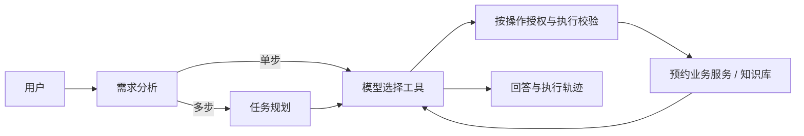

# 实验室预约 Agent

一个面向实验室与设备预约的 Agent 应用。用户可以用中文查实验室、设备、可预约时段和管理规定，也可以明确指示创建或取消自己的预约。前端展示流式回答、执行步骤和工具调用记录。

这个项目的重点是**让模型负责理解和选择工具，让代码负责写库边界与业务校验**。单步问题直接进入工具调用循环；需要多步查询时，模型可生成计划，按步骤调用工具，并在失败后调整尚未完成的步骤。



## 能做什么

- **真实业务工具**：查实验室、跨实验室找设备、查询时段与权限、创建和核验预约、查询和取消个人预约、检索制度文件。
- **写库控制**：仅根据本轮用户明确指定的操作开放对应工具。询问、含糊的“好的”、同时要求取消和重约都不会直接写库；模型即使输出其他写库工具名，执行节点也会拦截。取消目标不唯一时要求预约编号。
- **可观测性**：节点轨迹和工具调用结果分别落库；聊天记录留存 30 天，用户可查看和管理长期偏好。前端以 SSE 展示执行过程。
- **知识库**：`backend/data/kb/*.md` 按章节切片、增量同步到本地 Chroma，使用中文 embedding 检索。新增文件需重启后端。

技术栈：FastAPI、SQLAlchemy、MySQL、LangGraph、LangChain 工具调用、Chroma、sentence-transformers、Vue 3、Vite、Element Plus。

## 本地启动

需要 Python 3.11+、Node.js 22.18+（或 24.12+）、MySQL，以及支持 OpenAI 兼容接口和工具调用的模型服务。首次使用知识库时可能需要下载 embedding 模型 `BAAI/bge-small-zh-v1.5`。

1. 创建一个 MySQL 数据库，例如 `lab_agent`，并为应用账号授予建表及读写权限。后端启动时会通过 SQLAlchemy 创建缺失的表。
2. 安装依赖并配置密钥：

   ```bash
   python3 -m venv backend/.venv
   backend/.venv/bin/python -m pip install -r backend/requirements.txt
   cp backend/.env.example backend/.env
   ```

   编辑 `backend/.env`，填入 `DATABASE_URL`、`JWT_SECRET_KEY` 和自己的 `LLM_*` 配置。示例文件中的地址和密钥均是占位符。
3. 在两个终端分别运行：

   ```bash
   cd backend
   .venv/bin/python -m uvicorn app.main:app --port 8000 --loop asyncio
   ```

   ```bash
   cd frontend
   npm ci
   npm run dev
   ```

4. 打开 `http://localhost:5173/`，注册并登录后进入 `/manager/ai-chat`。接口文档位于 `http://localhost:8000/docs`。前端开发服务器会把 `/api` 代理到本地后端。

如需演示数据，可在**空的演示数据库**中执行 `backend/sql/seed_demo_data.sql`。该脚本会清空已有的实验室和设备数据，不应对正在使用的数据库运行。已有数据库变更目前需要手写迁移；`create_all()` 不会修改旧表结构。

## 演示路径

- “哪间实验室有 RTX4090？明天下午有空吗？”：观察按条件规划与分步工具调用。
- “实验室能带食物吗？”：观察知识库检索及来源内容。
- “帮我预约明天下午的计算机实验室”：补齐目标时段后提交预约，查看工具审计与预约状态。
- “帮我取消这个预约”：存在多个候选时要求指定编号；“能帮我取消吗？”只询问，不执行取消。

## 回归与评测

无需数据库和模型服务即可运行离线检查：

```bash
cd backend
.venv/bin/python -m unittest discover -s tests -v
.venv/bin/python -m evals.run
```

`tests/` 用脚本化模型与工具真实运行 LangGraph 执行图，并以独立内存 SQLite 检查真实预约写入、跨用户取消拦截和歧义取消。`evals/write_authorization.json` 包含 34 条授权用例，其中故意让模型给出错误授权判断；评测报告通过数、写库工具 precision 和 recall，失败时返回非零退出码。用例可直接扩充并重跑。

**评测边界**：脚本化工具返回值验证控制流与安全约束，不等于真实 LLM 的任务成功率、真实知识库召回率或生产环境并发性能。34 条授权用例也无法穷尽中文表达；面向生产写操作仍应增加由服务端保存目标的显式确认流程。实际端到端效果需配置数据库和模型服务后另行测量。当前预约服务是先查冲突再写入，尚未通过事务锁或数据库约束解决并发抢同一时段的问题。

详细的实现取舍与历史改造记录见 [`docs/agent-architecture.md`](docs/agent-architecture.md)。
