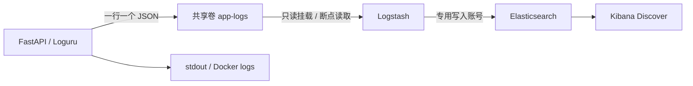

# ELK 日志采集与检索

根目录 Compose 提供可选的 `elk` profile，在现有应用栈上增加 Elasticsearch、Logstash 和 Kibana。三项服务统一使用官方 `9.5.5` 镜像，支持本机 ARM64。



Logstash 自身承担采集和解析，不需要再部署 Filebeat。日志通过 Docker 命名卷共享，不依赖 macOS 上 Docker VM 内部的容器日志路径，也不挂载 Docker socket。

## 启动与登录

项目根目录执行：

```bash
./scripts/start-elk.sh
```

脚本初始化缺失的随机密码，保留已有配置和数据，随后启用 `elk` profile 并构建、启动应用栈。等待服务健康后，再执行一次性 Kibana 视图初始化任务并自动清理该任务容器。

首次下载镜像需要数 GB 空间，启动通常需要一至数分钟。Docker 应分配至少约 6 GB 内存；本机实测配额约 8 GB。ELK 三项服务的内存上限合计 4 GB，独立于应用和模型推理所需内存。

| 服务 | 地址 | 登录方式 |
| --- | --- | --- |
| Kibana | <http://127.0.0.1:5601/app/discover> | 用户名 `elastic`，密码为根目录 `.env` 中的 `ELASTIC_PASSWORD` |
| Elasticsearch | <http://127.0.0.1:9200> | 同上，需要 Basic 认证 |
| Logstash | 仅 Compose 网络内部 | 无宿主机端口 |

根目录 `.env` 被 Git 忽略，权限为 0600。这里的密码与 `backend/.env` 中的模型密钥、Grafana 密码相互独立。浏览器登录使用 `elastic`；`kibana_system` 和 `lab_agent_writer` 供服务内部使用。

`elk-setup` 一次性配置服务账号、索引模板和生命周期策略，成功后显示 `Exited (0)` 是正常状态；三个 ELK 服务应为 `healthy`。`elk-views` 使用独立的 `elk-init` profile，由启动脚本显式执行，不作为常驻服务运行。

普通 `./scripts/start-stack.sh` 启动核心应用服务；带 ELK 的完整启动使用 `./scripts/start-elk.sh`。已经运行的 ELK 不会因执行普通启动命令而自动停止。手工执行 `docker compose --profile elk up -d --build --wait` 后，如需初始化视图，还应执行 `docker compose --profile elk run --rm --no-deps elk-views`。

## 查看应用日志

登录后进入 **Discover**，默认数据视图为 **Lab Agent · 后端日志**，索引匹配 `lab-agent-logs-*`，时间字段为 `@timestamp`。默认显示最近 15 分钟并每 10 秒刷新；选择更长时间范围可以查看历史记录。

通过前端执行注册、登录或业务查询后，数秒内即可出现请求完成记录。正常健康检查和 Prometheus 抓取不输出访问记录。当前采集后端 Python 日志；前端、MySQL、Redis 等其他容器日志仍使用 `docker compose logs` 查看。

Discover 搜索框使用 KQL，例如：

```text
event.action: "http_request"
```

```text
log.level: (error or critical)
```

```text
outcome: "business_error"
```

```text
request_id: "替换为浏览器响应头中的X-Request-ID"
```

默认列包含等级、路由、HTTP 状态、耗时、结果、请求 ID 和消息。`duration_ms` 将原始 `event.duration` 纳秒换算为毫秒；展开记录可查看 `error.stack_trace`。返回 HTTP 200 的业务错误也可通过 `outcome=business_error` 找到。

## 存储、权限与边界

- 后端 `LOG_FILE=/app/logs/backend.jsonl`，与 stdout 使用同一份脱敏 JSON。每份文件 10 MB，保留 3 份轮转备份；活动文件与备份合计约 40 MB。Logstash 直接解析 JSON，无需解码 Docker 日志封装。
- `logstash-data` 卷保存读取位置、持久化队列和死信。普通重启可续读；队列上限 256 MB、死信上限 64 MB。轮转采用重命名，采集路径包含活动文件和轮转文件，依据 [官方 file input 的轮转与 sincedb 机制](https://www.elastic.co/docs/reference/logstash/plugins/plugins-inputs-file)。
- `elasticsearch-data` 卷保存日志索引及 Kibana 保存对象。索引按 UTC 日期命名为 `lab-agent-logs-yyyy.MM.dd`，单分片、零副本，应用日志索引创建满 7 天后由 ILM 删除。策略按调度执行，不是精确到秒的删除，也不是磁盘用量硬上限。
- `kibana-data` 卷保存 Kibana 本地运行状态；加密密钥固定保存在根目录 `.env`，普通重启可继续使用。
- `lab_agent_writer` 只能监控集群和创建/追加 `lab-agent-logs-*` 文档，不能管理用户；Kibana 后台使用 `kibana_system`，初始化任务使用管理员账号。

这是本机单节点部署，HTTP 端口仅绑定 `127.0.0.1`，启用认证，内部 HTTP 未启用 TLS。生产部署应另行配置 HTTPS、用户权限、备份与容量规划。当前不回补接入前只存在于 Docker stdout 中的历史日志。

采集为异步流程，应用处理请求时无需等待 Elasticsearch。若 Logstash 停止时间过长，未采集文件超过本地轮转保留范围，旧记录可能丢失；异常断电也可能造成少量重复或丢失。此配置未实现严格恰好一次交付。

## 日常操作与验证

查看服务和日志：

```bash
docker compose --profile elk ps --all
docker compose --profile elk logs --tail=50 elasticsearch logstash kibana
```

执行端到端检查：

```bash
backend/.venv/bin/python backend/scripts/check_elk.py
```

额外验证停止采集期间的日志在重启后被补采：

```bash
backend/.venv/bin/python backend/scripts/check_elk.py --restart-logstash
```

该选项会暂时停止、再启动 Logstash，应用后端保持运行。检查内容包括真实 API 日志、请求 ID、HTTP 200 业务错误、脱敏、映射、认证、写入权限和 Kibana 默认视图。报告保存为被 Git 忽略的 `backend/profiles/elk-check.json`，不调用真实 LLM。

仅停止 ELK：

```bash
docker compose --profile elk stop kibana logstash elasticsearch
```

重复执行 `./scripts/start-elk.sh` 会复用现有数据视图，不删除用户索引或自建视图。修改挂载的 `logstash.yml`、pipeline 或 `kibana.yml` 后，需要运行 `docker compose --profile elk restart logstash kibana` 重新加载。模板更新影响随后新建的索引，不会重写历史索引字段类型；已有数据视图的修改可在 Kibana 中进行。

已有 Elasticsearch 数据卷时，管理员密码存储在 Elasticsearch 内部，单改 `.env` 的 `ELASTIC_PASSWORD` 不会修改实际密码，应通过密码 API 同步更改。不要删除数据卷来解决普通启动问题。

版本及接口参考：[Elastic 同版本安装要求](https://www.elastic.co/docs/deploy-manage/deploy/self-managed/installing-elasticsearch)、[Kibana 数据视图 API](https://www.elastic.co/docs/api/doc/kibana/operation/operation-createdataviewdefaultw)。

## 本机验证记录

2026-10-19 在 Docker Desktop `linux/arm64` 完成部署：9 个常驻服务均为 `healthy`，Elasticsearch 集群为 `green`。实际 API 产生的 HTTP 401 和 HTTP 200 业务错误均进入日志索引；Logstash 停止期间产生的请求在恢复后被补采，原有请求未被重复导入。重复一键启动也已通过，Kibana 数据视图保持同一 ID。

浏览器实际登录 Discover，按测试请求 ID 检索得到唯一记录，并正确显示路由、状态码、毫秒耗时和错误分类。ELK 实测占用约 2.6 GB 内存，随负载变化。后端完整回归为 507 项通过、1 项因缺少缓存模型跳过；34 条离线授权评测全部通过，原有应用及 Prometheus/Grafana 链路检查通过。

本地验证产物为 `backend/profiles/elk-check.json`、`elk-compose-check.json` 和 `elk-discover.png`，均不提交到 Git。本次未调用真实模型 API，也未进行新增日志链路的吞吐压测。
