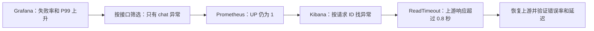

# 使用监控与日志定位一次 LLM 上游超时

演练在两个临时容器中运行：`incident-api` 是带真实 HTTP 调用的 API，`incident-upstream` 模拟 LLM 服务。复用项目的指标中间件、Loguru、请求 ID 和异常处理；不加载真实模型或连接业务数据库。正式后端保持运行。

故障开关将上游响应从约 30 ms 延长为 1.6 s，而 API 的读取超时为 0.8 s。因此聊天接口出现 `httpx.ReadTimeout`，最终返回 HTTP 500；独立查询接口仍正常。



## 一键复现

先确保应用和 ELK 已启动，再在项目根目录运行：

```bash
./scripts/start-elk.sh
backend/.venv/bin/python backend/scripts/run_incident_drill.py
```

默认执行正常、故障、恢复三个阶段，每阶段 35 秒，每秒发出 2 次聊天请求和 1 次查询请求。需要留出时间自己操作页面，可使用 `--phase-seconds 90`。这是低频诊断演练，不是容量压测。

脚本在 `finally` 中关闭故障、移除采集目标和两个临时容器；保留 Elasticsearch 日志及 Prometheus 历史序列。结果保存在被 Git 忽略的 `backend/profiles/incident-drill.json`，其中 `links` 提供带本次固定时间范围的 Grafana 和 Kibana 链接。演练结束后，8010 端口不再提供服务；回看时使用这些历史链接。

独立指标前缀为 `lab_agent_drill_*`，Prometheus job 为 `lab-agent-drill`，日志 `service.name` 为 `lab-agent-drill`。演练流量不会进入原后端大盘和原有 API 告警。这次验证指标和日志定位链路，未新增告警通知通道。

## 第一步：从 Grafana 发现异常

打开 <http://127.0.0.1:3001/d/lab-agent-incident-drill>，选择实例 `incident-api:8000`。演练过程中使用最近 5 分钟；结束后使用报告中的固定时间链接。

先观察“API 失败率”“P99 延迟”“各接口 QPS”。故障阶段预期约三分之二请求失败，因为每秒两个聊天请求失败、一个查询请求成功。分别筛选 `/api/drill/chat` 和 `/api/drill/catalog`：前者失败率为 100%，后者为 0%，由此缩小排查范围。

“采集状态”为 UP 表示 `/metrics` 可访问，不能据此判断所有业务依赖正常。QPS 按完成请求计算；本次发压速率固定为约 3 QPS，出现故障时不一定下降。

## 第二步：用 Prometheus 验证口径

打开 <http://127.0.0.1:9091/query>，故障期间分别查询：

```promql
up{job="lab-agent-drill"}
```

```promql
sum by (route, status, outcome) (
  rate(lab_agent_drill_http_requests_total{job="lab-agent-drill",route=~"/api/drill/.*"}[20s])
)
```

第二条查询应看到 `chat + 500 + exception` 与 `catalog + 200 + success`。聊天接口 P99 查询为：

```promql
histogram_quantile(0.99,
  sum by (le) (
    rate(lab_agent_drill_http_request_duration_seconds_bucket{
      job="lab-agent-drill",route="/api/drill/chat"
    }[20s])
  )
)
```

该查询单位为秒。项目抓取间隔为 5 秒，20 秒窗口用于这次短演练；生产观察窗口和告警持续时间应按流量调整。P99 来自桶内插值，可能接近 1 秒，而客户端实际 P99 约为 0.8 秒。两者统计方法不同，不能直接当作测量矛盾，机制见 [Prometheus 官方分位数说明](https://prometheus.io/docs/prometheus/latest/querying/functions/#histogram_quantile)。

## 第三步：通过请求 ID 找到异常堆栈

演练故障阶段，在另一个终端请求：

```bash
curl -i -X POST http://127.0.0.1:8010/api/drill/chat \
  -H 'X-Request-ID: my-incident-001'
```

查看 HTTP 状态和响应头 `X-Request-ID`，然后进入 <http://127.0.0.1:5601/app/discover>，选择 `Lab Agent · 后端日志`，在 KQL 搜索框输入：

```text
service.name: "lab-agent-drill" and request_id: "my-incident-001"
```

也可直接打开报告中的 `links.kibana_request`，查询脚本已记录的失败请求。展开记录后看这些字段：

| 字段 | 排查用途 |
| --- | --- |
| `http.response.status_code`、`outcome` | 确认是 500 / exception |
| `event.duration`、`duration_ms` | 确认请求主要花费约 800 ms；原始 duration 单位为纳秒 |
| `error.type` | 本次为 `LLMUpstreamTimeout` |
| `error.message` | 给出上游地址和 `read_timeout=0.8s` |
| `error.stack_trace` | 查看异常链中的 `httpx.ReadTimeout`，以及 `/drill/incident_app.py` 的调用位置 |

由此确认故障发生在调用 LLM 上游的读取阶段。[HTTPX 官方说明](https://www.python-httpx.org/advanced/timeouts/) 将这种在指定时间内未收到数据的情况归为读取超时。这一证据将排查范围收敛到上游响应、网络路径和调用超时预算。

## 第四步：恢复并验证

自动脚本会在故障阶段结束后恢复上游。实际线上遇到同类问题，应结合依赖健康检查和发布记录，选择回滚上游变更、切换健康节点或临时降级；修改超时需要结合上游 SLA、连接池和重试预算评估。

恢复后连续请求成功，聊天耗时回到几十毫秒；在新的 20 秒窗口中确认失败率降至 0、P99 回落，同时查询接口保持正常。历史窗口可能仍含有故障样本，观察时应核对时间范围。

需要提前终止时，先在演练终端按 Ctrl+C，等清理结束。若脚本被强制杀死，可执行：

```bash
backend/.venv/bin/python backend/scripts/run_incident_drill.py --cleanup
```

该命令只清理 `incident-api`、`incident-upstream` 和演练采集目标，不执行整栈 `down`。

## 何时使用其他工具

| 观察到的现象 | 下一步工具 |
| --- | --- |
| 错误率或延迟上升，需要确定范围 | Prometheus + Grafana，按接口和实例筛选 |
| 某次请求报错，需要调用位置和异常原因 | Kibana + Loguru，通过请求 ID 关联 |
| 真实 Agent 多步骤耗时，想分辨模型、工具、RAG、缓存 | 按 [LangSmith 指南](langsmith.md) 查看追踪；本次本地模拟不调用真实模型 |
| CPU 持续高，Python 计算热点不明确 | 按 [性能指南](performance.md) 使用 py-spy 采样，再用 cProfile 做可重复分析 |

本次依据异常链定位到上游读取超时；CPU 火焰图不是定位这一故障所必需的证据。

## 本次实测记录

2026-10-19 在本机完成一次演练，每阶段 105 个请求，共 315 个。

| 阶段 | API 完成 QPS（Prometheus） | 总体失败率 | 聊天 P99（客户端） | 聊天 P99（直方图估算） |
| --- | ---: | ---: | ---: | ---: |
| 正常 | 3.00 | 0.0% | 49.0 ms | 49.75 ms |
| 故障 | 3.00 | 66.7% | 833.0 ms | 995.00 ms |
| 恢复 | 2.93 | 0.0% | 43.5 ms | 49.75 ms |

失败请求 ID：`incident-aa1d470954-fault-1`。日志确认 `LLMUpstreamTimeout` 由 `httpx.ReadTimeout` 引起，读取超时为 0.8 秒。三个阶段采集状态均为 UP，查询接口全部成功。

[打开故障阶段 Grafana](http://127.0.0.1:3001/d/lab-agent-incident-drill?from=1792408693045&to=1792408768285&var-instance=incident-api%3A8000) · [查看恢复趋势](http://127.0.0.1:3001/d/lab-agent-incident-drill?from=1792408693045&to=1792408808409&var-instance=incident-api%3A8000) · [打开对应 Kibana 日志](http://127.0.0.1:5601/app/discover#/?_a=%28columns%3A%21%28log.level%2Croute%2Chttp.response.status_code%2Cduration_ms%2Coutcome%2Crequest_id%2Cmessage%29%2Cindex%3A%278970d1b8-b808-45df-afc6-63dc14ed470b%27%2Cquery%3A%28language%3Akuery%2Cquery%3A%27request_id%3A+%22incident-aa1d470954-fault-1%22%27%29%29&_g=%28time%3A%28from%3A%272026-10-19T11%3A18%3A13.045299%2B00%3A00%27%2Cto%3A%272026-10-19T11%3A20%3A08.409273%2B00%3A00%27%29%29)

上述链接固定到本次演练时间，临时服务已经恢复并移除。原有 9 个常驻服务保持健康；46 项指标与日志回归通过，Prometheus 配置和 6 条既有规则校验通过。历史数据按现有保留策略清理后，可重新运行演练生成新的链接。

浏览器验证时还修正了失败率卡片的着色：使用已配置的阈值，超过 5% 显示红色。截图位于 `backend/profiles/incident-grafana.png`、`backend/profiles/incident-kibana.png`。
